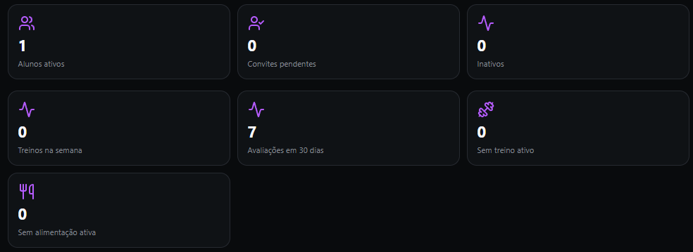
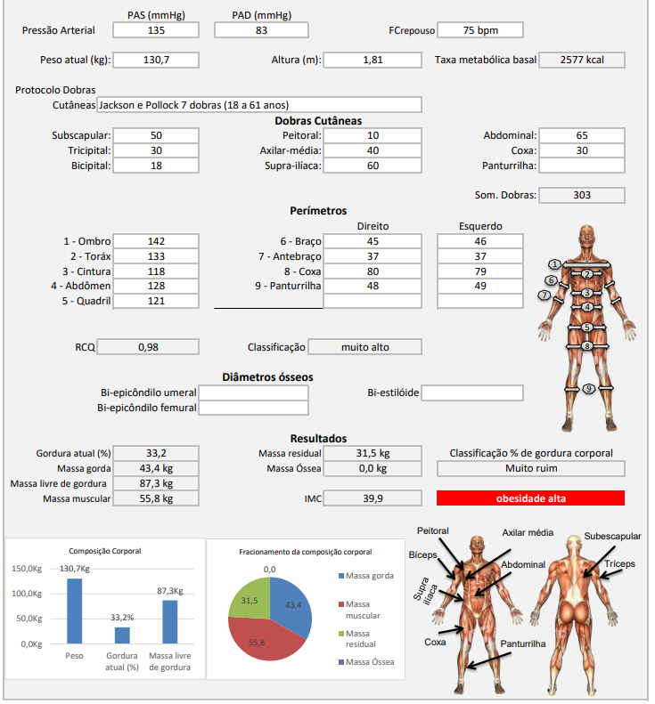
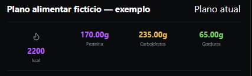

# Manual de uso — IS COACH TREINAMENTO

## Apresentação

Este manual explica, em linguagem simples, como o professor e os alunos utilizam o IS COACH TREINAMENTO. As telas podem receber pequenos ajustes visuais até a publicação definitiva, mas os fluxos descritos correspondem ao funcionamento atual do sistema.

> **Importante:** dados de saúde, fotos e informações pessoais devem ser acessados somente para a finalidade profissional autorizada pelo aluno. Não compartilhe senhas nem deixe uma sessão aberta em aparelho de terceiros.

## 1. Acesso ao sistema

Abra o endereço fornecido pelo responsável pelo sistema. Na tela de entrada:

1. Informe o e-mail cadastrado.
2. Informe a senha.
3. Selecione **Entrar**.

Se os dados estiverem incorretos, o sistema exibirá uma mensagem sem revelar se o e-mail existe. Confira a digitação ou utilize **Esqueci minha senha**.

### Recuperar a senha

1. Na tela de entrada, selecione **Esqueci minha senha**.
2. Informe seu e-mail.
3. Abra a mensagem recebida e acesse o link de recuperação.
4. Cadastre a nova senha dentro de 30 minutos.

A nova senha precisa ter pelo menos 10 caracteres e incluir:

- uma letra maiúscula;
- uma letra minúscula;
- um número;
- um símbolo, como `@`, `.`, `!` ou `#`.

Se o link expirar, solicite outro. Nunca encaminhe o link ou a senha a terceiros.

### Sair com segurança

- **Professor:** use o botão **Sair**, no cabeçalho do painel.
- **Aluno:** abra **Perfil** e selecione **Sair da conta**.

Sempre saia ao utilizar um aparelho compartilhado.

## 2. Primeiro acesso do aluno

O cadastro do aluno é iniciado por um convite do professor.

1. O professor cria o convite informando nome, e-mail e validade de 1, 2 ou 3 dias.
2. O aluno recebe o link por e-mail.
3. O aluno abre o convite antes do vencimento.
4. O próprio aluno completa seu cadastro e cria a senha.
5. O sistema apresenta os termos, a política de privacidade e as autorizações vigentes.
6. O aluno lê e realiza seus próprios aceites.

O professor nunca aceita termos em nome do aluno. Convites vencidos, cancelados ou já utilizados deixam de funcionar. Para um ex-aluno com conta inativa, o professor deve reativar o cadastro existente em vez de criar outro.

## 3. Área do professor

### 3.1 Entendendo o painel

Ao entrar como professor, a primeira tela apresenta os principais números da operação.

Os indicadores significam:

| Indicador | O que representa | Como o número muda |
|---|---|---|
| Alunos ativos | Alunos com acesso liberado | Ativação, reativação ou inativação da conta |
| Convites pendentes | Convites ainda válidos e não utilizados | Criação, uso, cancelamento ou vencimento do convite |
| Inativos | Contas de alunos sem acesso | Inativação ou reativação pelo professor |
| Treinos na semana | Sessões concluídas pelos alunos na semana atual | O aluno conclui um treino |
| Avaliações em 30 dias | Avaliações registradas no período | O professor cria uma avaliação |
| Sem treino ativo | Alunos ativos que não possuem plano de treino ativo | Publicação, arquivamento ou exclusão de planos |
| Sem alimentação ativa | Alunos ativos que não possuem plano alimentar ativo | Publicação, arquivamento ou exclusão de planos |

As abas principais são **Alunos**, **Treinos**, **Avaliações** e **Alimentação**.

### 3.2 Selecionar um aluno

O fluxo recomendado começa pela escolha do aluno:

1. Abra **Alunos**.
2. Use a busca por nome ou e-mail, se necessário.
3. Selecione o cadastro desejado.
4. Navegue para **Treinos**, **Avaliações** ou **Alimentação**.

O aluno permanece selecionado durante a navegação. Antes de salvar qualquer informação, confirme se o nome exibido é o correto.

### 3.3 Convidar um aluno

1. Em **Alunos**, selecione **Convidar**.
2. Informe o nome e o e-mail do aluno.
3. Escolha a validade entre 1 e 3 dias.
4. Envie o convite.
5. Se desejar, copie o link exibido no painel e encaminhe diretamente ao aluno.

O envio por e-mail depende da configuração do servidor. O link copiado possui a mesma validade e não deve ser publicado em grupos ou redes sociais.

### 3.4 Cadastro e acesso do aluno

Após selecionar um aluno, a aba **Cadastro** permite atualizar os dados pessoais, endereço, objetivos e observações profissionais.

- Ao preencher o CEP e sair do campo, o sistema tenta completar o endereço.
- Confira rua, bairro, cidade e UF antes de salvar.
- Complete manualmente número e complemento.
- Use **Desativar** para suspender o acesso sem apagar o histórico.
- Use **Reativar** para devolver o acesso a uma conta inativa.

#### Exclusão definitiva

A exclusão definitiva remove o cadastro operacional do aluno e não deve ser usada apenas para suspender o acesso. Confira cuidadosamente o nome apresentado na confirmação. Quando houver dúvida, prefira **Desativar**.

### 3.5 Anamnese

1. Selecione o aluno.
2. Abra **Anamnese**.
3. Preencha as respostas durante a entrevista ou consulta.
4. Marque as respostas do PAR-Q conforme as informações fornecidas pelo aluno.
5. Selecione **Salvar anamnese**.

A anamnese pode ser preenchida pelo professor durante a consulta presencial. Registre somente informações necessárias e não transforme observações em diagnósticos fora da sua competência profissional.

## 4. Treinos — professor

### 4.1 Biblioteca de exercícios

Abra **Treinos** e depois **Biblioteca**.

Para cadastrar um exercício:

1. Informe o nome.
2. Escolha o agrupamento muscular.
3. Inclua instruções, quando necessário.
4. O vídeo é opcional; o exercício pode ser salvo sem ele.
5. Selecione **Adicionar à biblioteca**.

Para alterar um exercício existente, selecione **Editar** no próprio card, faça as mudanças e salve. Um vídeo pode ser incluído posteriormente. Quando não houver imagem própria, o aplicativo utiliza uma imagem padrão relacionada a treino.

### 4.2 Montar um treino

1. Primeiro selecione o aluno na aba **Alunos**.
2. Abra **Treinos** e **Montar treino**.
3. Informe nome, subtítulo, duração aproximada e status.
4. Se desejar, escolha o dia da semana. Esse campo é opcional.
5. Para cada item, filtre pelo agrupamento muscular ou pesquise o nome do exercício.
6. Selecione o exercício sugerido pelo preenchimento automático.
7. Informe séries, faixa de repetições, descanso, carga sugerida e observações.
8. Inclua atividades complementares quando forem necessárias.
9. Salve o treino.

Cadastrar um treino novo não substitui os anteriores. Todos os treinos do aluno ficam listados um abaixo do outro.

### 4.3 Modelos de treino

Use modelos para prescrições repetidas, como “Peito e tríceps” ou “Costas e bíceps”.

1. Monte uma prescrição genérica.
2. Salve como modelo/atalho.
3. Ao atender outro aluno, carregue o modelo.
4. Personalize cargas, repetições, descanso e observações.
5. Salve como treino do aluno.

O modelo serve como ponto de partida e não substitui a revisão individual.

### 4.4 Consultar, editar ou excluir treino

Na seção **Treinos deste aluno**:

- selecione **Ver prescrição** para conferir os exercícios;
- selecione **Editar treino** para abrir todos os campos no próprio card;
- salve as alterações ou feche a edição;
- selecione **Excluir treino** somente quando quiser remover a prescrição definitivamente.

O histórico de sessões já realizadas é preservado por meio de uma cópia da prescrição usada naquele momento.

### 4.5 Status do treino

- **Ativo:** aparece para o aluno e pode ser executado.
- **Arquivado:** deixa de ser o plano disponível, mas permanece no histórico administrativo.

Não existe status de rascunho no fluxo atual.

## 5. Avaliações físicas — professor

1. Selecione o aluno.
2. Abra **Avaliações**.
3. Crie uma nova avaliação e informe a data.
4. Preencha somente os dados coletados na consulta.
5. Confira as unidades dos campos antes de salvar.
6. O sistema calcula os resultados automaticamente.
7. Inclua as fotos permitidas pelo consentimento do aluno.
8. Salve/finalize a avaliação.

Os cálculos não devem ser editados manualmente. Para corrigir uma avaliação finalizada, utilize a função de correção; assim, a versão anterior permanece no histórico.

Para excluir uma avaliação, localize o registro correto no histórico, selecione **Excluir avaliação** e confirme a ação. Confira a data e a versão antes de confirmar, pois a exclusão é definitiva. Quando a intenção for apenas corrigir valores, use a correção em vez da exclusão.

É possível comparar avaliações e acompanhar peso, percentual de gordura, massa muscular, cintura e outros indicadores disponíveis. Fotos podem ser substituídas ou excluídas.

> A imagem abaixo foi utilizada como referência dos campos e resultados durante a construção. A tela definitiva do aplicativo segue o mesmo conteúdo em formato mobile.

Não fazem parte da tela atual: teste físico, teste de flexibilidade, diâmetros ósseos e dobra cutânea da panturrilha.

## 6. Alimentação — professor

1. Selecione o aluno.
2. Abra **Alimentação**.
3. Crie o plano e informe nome e metas nutricionais.
4. Cadastre as refeições e seus horários.
5. Adicione os alimentos de cada refeição.
6. Cadastre substituições por alimento, quando necessário.
7. Informe a meta de hidratação.
8. Preencha suplementos e recursos ergogênicos nas áreas próprias.
9. Defina o plano como **Ativo** ou **Arquivado** e salve.

O resumo apresenta ícones e valores de calorias, proteínas, carboidratos e gorduras.

- **Ativo:** plano exibido ao aluno.
- **Arquivado:** preservado para consulta administrativa, mas não apresentado como plano atual.

Suplementos e recursos ergogênicos devem ser registrados de acordo com a orientação profissional aplicável. O sistema organiza a informação; ele não substitui avaliação médica ou nutricional.

### 6.1 Revisar e versionar um plano

Na seção **Planos e histórico**, selecione **Revisar** para carregar o conteúdo de um plano no formulário. Ao salvar a revisão:

- o sistema cria uma nova versão do plano;
- a versão anterior é arquivada automaticamente;
- se a nova versão for salva como **Ativa**, ela passa a ser o plano atual do aluno;
- se a nova versão for salva como **Arquivada**, o aluno ficará sem esse plano ativo até que outra versão ativa seja criada.

Esse versionamento permite consultar o que foi prescrito anteriormente. Por isso, revisar um plano não altera nem apaga diretamente o registro antigo.

### 6.2 Excluir um plano alimentar

O botão **Excluir plano** remove somente a versão escolhida no histórico. Para proteger o plano que está em uso pelo aluno, o sistema não permite excluir uma versão com status **Ativo**.

Para excluir:

1. Confira o nome, a data e o status do plano.
2. Se estiver ativo, selecione **Revisar**.
3. Altere a nova versão para **Arquivado** e salve.
4. Volte a **Planos e histórico**.
5. Selecione **Excluir plano** na versão que deseja remover.
6. Leia a confirmação e conclua somente se tiver certeza.

Ao salvar uma revisão arquivada, tanto a versão anterior quanto a nova podem aparecer como arquivadas. Elas são registros separados e, se necessário, devem ser excluídas individualmente.

O botão de exclusão também permanece temporariamente bloqueado enquanto outra revisão ou exclusão está em andamento. Finalize ou cancele a revisão antes de tentar novamente.

> **Atenção:** se ainda existir um plano que o aluno deva seguir, publique primeiro a versão correta como **Ativa**. A exclusão é definitiva e não possui restauração pela interface.

## 7. Área do aluno

### 7.1 Página inicial

A tela inicial mostra:

- próximo treino ou sessão em andamento;
- quantidade de treinos concluídos na semana;
- atalhos para evolução, avaliação física, alimentação e perfil;
- botão para falar com o professor pelo WhatsApp;
- sino de notificações.

Ao abrir o sino, selecione uma atualização para ir ao conteúdo relacionado ou use **Marcar todas como lidas**. O estado de leitura fica salvo no navegador utilizado; ele ainda não é sincronizado entre aparelhos.

### 7.2 Consultar e executar treinos

1. Abra **Treino** no menu inferior.
2. Consulte todos os treinos disponíveis, exibidos um abaixo do outro.
3. Abra o treino desejado.
4. Consulte a instrução e, quando disponível, reproduza o vídeo dentro do aplicativo.
5. Inicie a sessão.
6. Registre carga e repetições de cada série.
7. Marque as séries concluídas.
8. Registre atividades complementares.
9. Selecione **Concluir treino** ao terminar.

Se fechar a tela durante uma sessão, use **Continuar treino** na página inicial. Não conclua o treino antes de revisar os registros.

### 7.3 Evolução e avaliações

Abra **Evolução** para visualizar:

- última avaliação;
- diferença em relação à avaliação anterior;
- gráfico por indicador;
- comparação de fotos autorizadas;
- histórico completo das avaliações publicadas.

Os dados são inseridos pelo professor. Se encontrar uma informação incorreta, peça a correção; não tente compensar o erro em outro campo.

### 7.4 Plano alimentar e hidratação

Abra **Dieta/Alimentação** para consultar refeições, alimentos, quantidades, horários, substituições, suplementos e recursos ergogênicos.

Use o controle de hidratação para registrar o consumo de água. O progresso diário é calculado em relação à meta definida no plano ativo.

### 7.5 Perfil

Na aba **Perfil**, o aluno pode:

- atualizar seus dados e endereço;
- alterar ou remover a foto;
- trocar a senha;
- solicitar alteração de e-mail;
- consultar, aceitar ou revogar consentimentos quando permitido;
- sair da conta.

A foto enviada é comprimida para economizar espaço. Use uma imagem nítida, preferencialmente frontal, em JPG, PNG ou WebP.

Ao trocar o e-mail, abra a mensagem enviada ao novo endereço e confirme em até 30 minutos.

## 8. Consentimentos e privacidade

Os documentos são explicados no primeiro acesso. O aluno deve ler e aceitar pessoalmente cada documento obrigatório.

- O professor não pode aceitar pelo aluno.
- Uma nova versão obrigatória pode exigir novo aceite.
- A revogação pode limitar recursos que dependem daquele consentimento.
- A autorização de imagens controla o uso das fotos de avaliação conforme o texto jurídico vigente.

O conteúdo jurídico definitivo deve ser aprovado pelo advogado do cliente antes da publicação.

## 9. Mensagens e situações comuns

| Situação | O que fazer |
|---|---|
| “E-mail ou senha inválidos” | Confira os dados ou use a recuperação de senha |
| Convite não chegou | Verifique spam, confirme o e-mail e copie o link pelo painel |
| Convite expirou | O professor deve criar outro convite |
| Conta inativa | Solicite a reativação ao professor |
| CEP não encontrado | Confira os oito números e complete o endereço manualmente |
| Vídeo não abre | Verifique a internet e peça ao professor para revisar o link |
| Nenhum treino ativo | O professor deve ativar uma prescrição para o aluno |
| Nenhuma alimentação ativa | O professor deve ativar um plano alimentar |
| Botão “Excluir plano” bloqueado | O plano está ativo ou há uma revisão/exclusão em andamento; arquive-o e finalize ou cancele a edição |
| Surgiram duas versões arquivadas | Uma revisão cria um novo registro e arquiva o anterior; confira as datas e exclua cada versão indesejada separadamente |
| Foto não envia | Confira formato, conexão e tente outra imagem |
| E-mail de recuperação não chegou | Verifique spam e solicite um novo link após alguns minutos |

## 10. Checklist rápido do professor

### Novo aluno

- [ ] Criar e enviar o convite.
- [ ] Confirmar que o aluno concluiu o cadastro e os consentimentos.
- [ ] Revisar cadastro e anamnese.
- [ ] Registrar a avaliação inicial.
- [ ] Publicar pelo menos um treino ativo.
- [ ] Publicar o plano alimentar, quando fizer parte do acompanhamento.

### Atendimento de retorno

- [ ] Selecionar e confirmar o aluno correto.
- [ ] Atualizar anamnese quando necessário.
- [ ] Registrar nova avaliação e fotos autorizadas.
- [ ] Comparar com o histórico.
- [ ] Atualizar treinos e alimentação.
- [ ] Confirmar se os planos corretos estão ativos.

### Encerramento ou pausa

- [ ] Arquivar planos que não devem mais aparecer para o aluno.
- [ ] Antes de excluir um plano alimentar, confirmar que ele está arquivado e que a versão correta continua disponível.
- [ ] Preservar o histórico profissional.
- [ ] Desativar o acesso do aluno quando necessário.
- [ ] Usar exclusão definitiva somente quando ela for realmente necessária e estiver de acordo com as obrigações legais.

## 11. Suporte

Para dúvidas sobre treino, avaliação ou alimentação, utilize **Falar com o professor** no aplicativo.

Para problemas técnicos, informe:

- qual perfil estava usando: professor ou aluno;
- qual tela estava aberta;
- o texto exato da mensagem apresentada;
- data e horário aproximados;
- modelo do celular e navegador;
- uma captura da tela, sem expor senha ou informação desnecessária de saúde.

---

**IS COACH TREINAMENTO — Manual de uso**  
Versão documental: 1.1 — 15/09/2026
